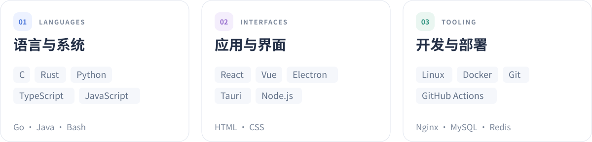
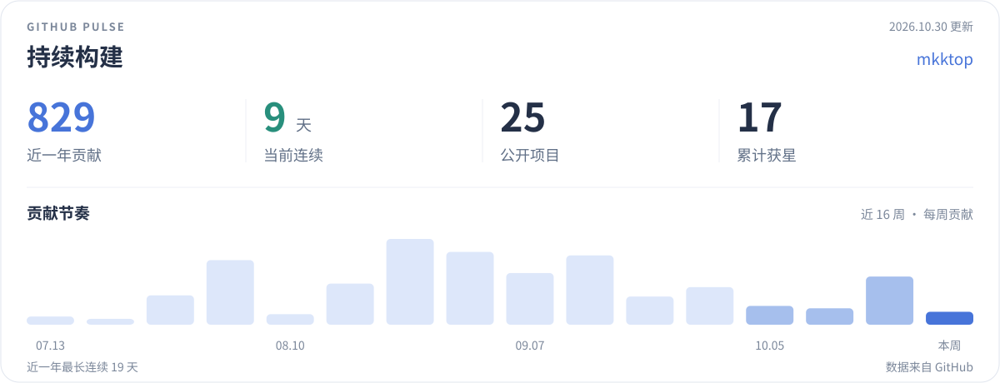

  <picture>
    <source media="(max-width: 600px)" srcset="./assets/hero-mobile.svg" />
    
  </picture>

  <strong>写底层，也造应用。把好奇心，变成跑得起来的作品。</strong>

  
  
  

  <a href="#about">关于我</a> &nbsp; / &nbsp;
  <a href="#projects">精选作品</a> &nbsp; / &nbsp;
  <a href="#stack">技术栈</a> &nbsp; / &nbsp;
  <a href="#activity">开发足迹</a> &nbsp; / &nbsp;
  <a href="#services">公共服务</a>

 

## 01 / 关于我

嗨，我是 **mkktop**。喜欢在硬件与软件之间搭桥，从一帧通信协议到一个完整界面，把想法做成能用的工具。

- **Embedded** — STM32、FreeRTOS、LVGL、Modbus，探索设备背后的逻辑。
- **Desktop & Web** — TypeScript、Vue、Electron，让复杂能力拥有顺手的界面。
- **AI & Automation** — Python、多模态 API、本地媒体处理，把重复的事交给程序。

> 从寄存器到像素，从一个想法到一次发布。保持好奇，持续构建。

 

## 02 / 精选作品

<table>
  <tr>
    <td width="50%" valign="top">
      
      <h3><a href="https://github.com/mkktop/bilbili_copy">未雨 · bilbili_copy</a></h3>
      
基于 Tauri 2 的 B 站桌面客户端，集成视频浏览、内置播放器、多线程下载与断点续传，支持弹幕字幕和批量队列。

      
<code>Rust</code> <code>React</code> <code>Tauri 2</code>

      <a href="https://github.com/mkktop/bilbili_copy/releases">下载体验 ↗</a> &nbsp; · &nbsp; <a href="https://github.com/mkktop/bilbili_copy">查看源码</a>
    </td>
    <td width="50%" valign="top">
      
      <h3><a href="https://github.com/mkktop/Yiben">雨读 · Yiben</a></h3>
      
本地与云盘漫画阅读器，支持压缩包、EPUB 和 PDF，打通天翼云盘、115 与 WebDAV，提供离线缓存和阅读进度管理。

      
<code>TypeScript</code> <code>React</code> <code>Electron</code>

      <a href="https://github.com/mkktop/Yiben">探索项目 ↗</a>
    </td>
  </tr>
  <tr>
    <td width="50%" valign="top">
      
      <h3><a href="https://github.com/mkktop/super_video">雨帧 · super_video</a></h3>
      
视频、图片与漫画的本地 AI 超分工作台。集成模型对比、补帧和批量队列，让画质提升有一套完整流程。

      
<code>Python</code> <code>Electron</code> <code>AI / Media</code>

      <a href="https://github.com/mkktop/super_video/releases">下载体验 ↗</a> &nbsp; · &nbsp; <a href="https://github.com/mkktop/super_video">查看源码</a>
    </td>
    <td width="50%" valign="top">
      
      <h3><a href="https://github.com/mkktop/yusheng">语声 · yusheng</a></h3>
      
面向 dsh 生态的语音插件库，串联语音识别、流式合成与 AI 会话，支持独立客户端配置、人设和结构化长期记忆。

      
<code>Node.js</code> <code>WebSocket</code> <code>ASR / TTS</code>

      <a href="https://github.com/mkktop/yusheng">探索项目 ↗</a>
    </td>
  </tr>
</table>

  <a href="https://github.com/mkktop?tab=repositories">浏览全部开源项目 ↗</a>

 

## 03 / 技术栈

  <picture>
    <source media="(max-width: 600px) and (prefers-color-scheme: dark)" srcset="./assets/stack-mobile-dark.svg" />
    <source media="(max-width: 600px)" srcset="./assets/stack-mobile-light.svg" />
    <source media="(prefers-color-scheme: dark)" srcset="./assets/stack-dark.svg" />
    
  </picture>

## 04 / 开发足迹

  <picture>
    <source media="(max-width: 600px) and (prefers-color-scheme: dark)" srcset="./assets/activity-mobile-dark.svg" />
    <source media="(max-width: 600px)" srcset="./assets/activity-mobile-light.svg" />
    <source media="(prefers-color-scheme: dark)" srcset="./assets/activity-dark.svg" />
    
  </picture>

 

## 05 / 公共服务

🖼️ **公共图床** · [image.kaikun.top ↗](https://image.kaikun.top/)

访问密码：`373737`

 

  

