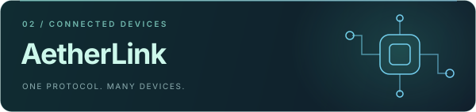
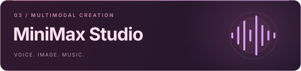
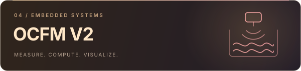

  <picture>
    <source media="(max-width: 600px)" srcset="./assets/hero-mobile.svg" />
    
  </picture>

  <strong>写底层，也造应用。把好奇心，变成跑得起来的作品。</strong>

  
  
  

  <a href="#about">关于我</a> &nbsp; / &nbsp;
  <a href="#projects">精选作品</a> &nbsp; / &nbsp;
  <a href="#stack">技术栈</a> &nbsp; / &nbsp;
  <a href="#activity">开发足迹</a> &nbsp; / &nbsp;
  <a href="#services">公共服务</a>

 

## 01 / 关于我

嗨，我是 **mkktop**。喜欢在硬件与软件之间搭桥，从一帧通信协议到一个完整界面，把想法做成能用的工具。

- **Embedded** — STM32、FreeRTOS、LVGL、Modbus，探索设备背后的逻辑。
- **Desktop & Web** — TypeScript、Vue、Electron，让复杂能力拥有顺手的界面。
- **AI & Automation** — Python、多模态 API、本地媒体处理，把重复的事交给程序。

> 从寄存器到像素，从一个想法到一次发布。保持好奇，持续构建。

 

## 02 / 精选作品

<table>
  <tr>
    <td width="50%" valign="top">
      
      <h3><a href="https://github.com/mkktop/super_video">雨帧 · RainFrame</a></h3>
      
视频、图片与漫画的本地 AI 超分工作台。集成模型对比、补帧和批量队列，让画质提升有一套完整流程。

      
<code>Python</code> <code>Electron</code> <code>AI / Media</code>

      <a href="https://github.com/mkktop/super_video/releases">下载体验 ↗</a> &nbsp; · &nbsp; <a href="https://github.com/mkktop/super_video">查看源码</a>
    </td>
    <td width="50%" valign="top">
      
      <h3><a href="https://github.com/mkktop/AetherLink">AetherLink</a></h3>
      
面向多产品的仪表上位机。以设备包驱动界面，通过统一 Modbus 协议与可插拔链路连接不同设备。

      
<code>TypeScript</code> <code>Vue 3</code> <code>Electron</code>

      <a href="https://github.com/mkktop/AetherLink">探索项目 ↗</a>
    </td>
  </tr>
  <tr>
    <td width="50%" valign="top">
      
      <h3><a href="https://github.com/mkktop/minimax_tts">MiniMax Studio</a></h3>
      
把语音合成、图像生成与音乐创作放进同一个 Web 工作室，支持流式语音、音色复刻和多模态创作。

      
<code>JavaScript</code> <code>Node.js</code> <code>WebSocket</code>

      <a href="https://github.com/mkktop/minimax_tts">探索项目 ↗</a>
    </td>
    <td width="50%" valign="top">
      
      <h3><a href="https://github.com/mkktop/OCFM_V2">OCFM V2 · 明渠流量计</a></h3>
      
基于 STM32F407 的流量计固件，涵盖传感器采集、堰槽流量计算、历史记录与 LVGL 图形界面。

      
<code>C</code> <code>FreeRTOS</code> <code>LVGL</code> <code>Modbus</code>

      <a href="https://github.com/mkktop/OCFM_V2">探索项目 ↗</a>
    </td>
  </tr>
</table>

  还有这些小工具：<a href="https://github.com/mkktop/mkk_comic">漫画自动下载与管理</a> &nbsp; · &nbsp;
  <a href="https://github.com/mkktop/STM32F407_bootloader">STM32 Bootloader</a> &nbsp; · &nbsp;
  <a href="https://github.com/mkktop?tab=repositories">全部仓库 ↗</a>

 

## 03 / 技术栈

<strong>语言与逻辑</strong>

<strong>应用与界面</strong>

<strong>开发与部署</strong>

 

## 04 / 开发足迹

  
  

  

 

## 05 / 公共服务

🖼️ **公共图床** · [image.kaikun.top ↗](https://image.kaikun.top/)

访问密码：`373737`

 

  

